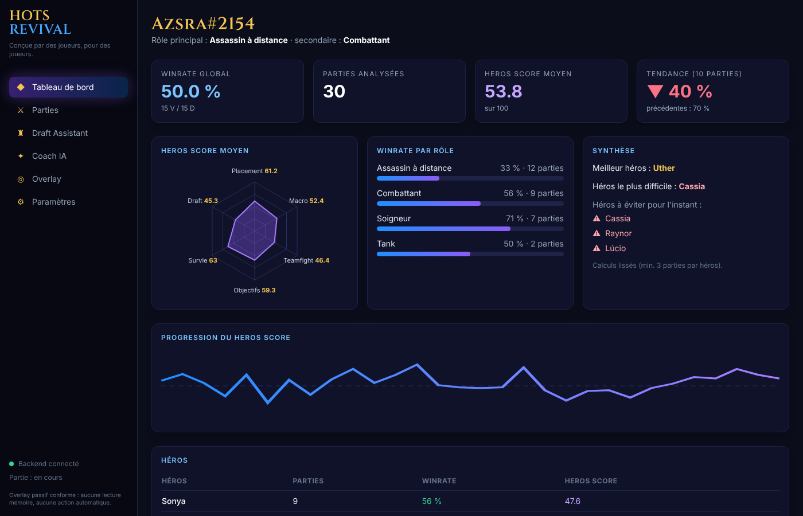
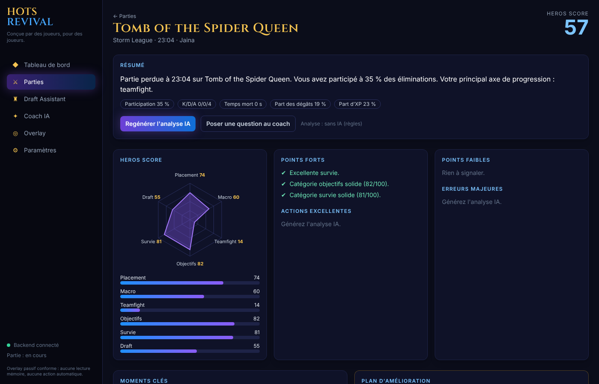
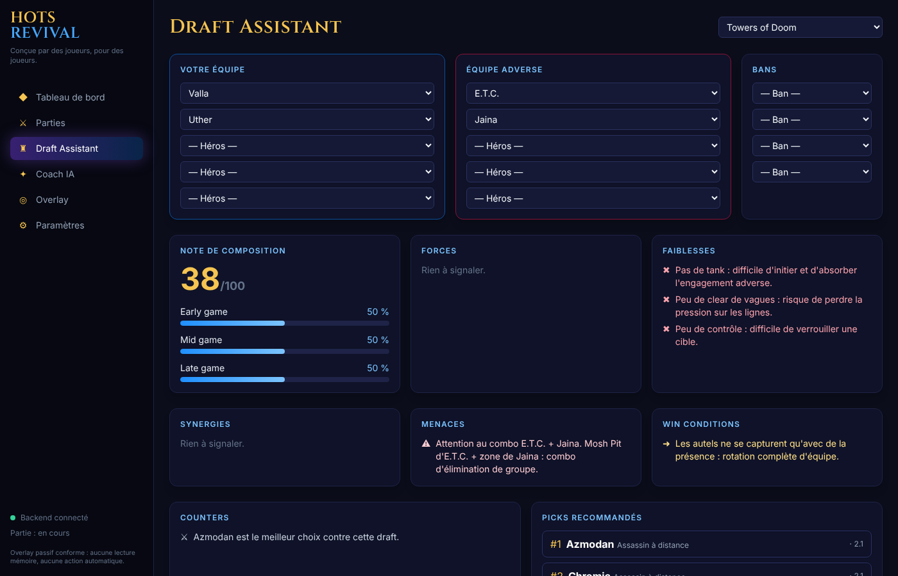
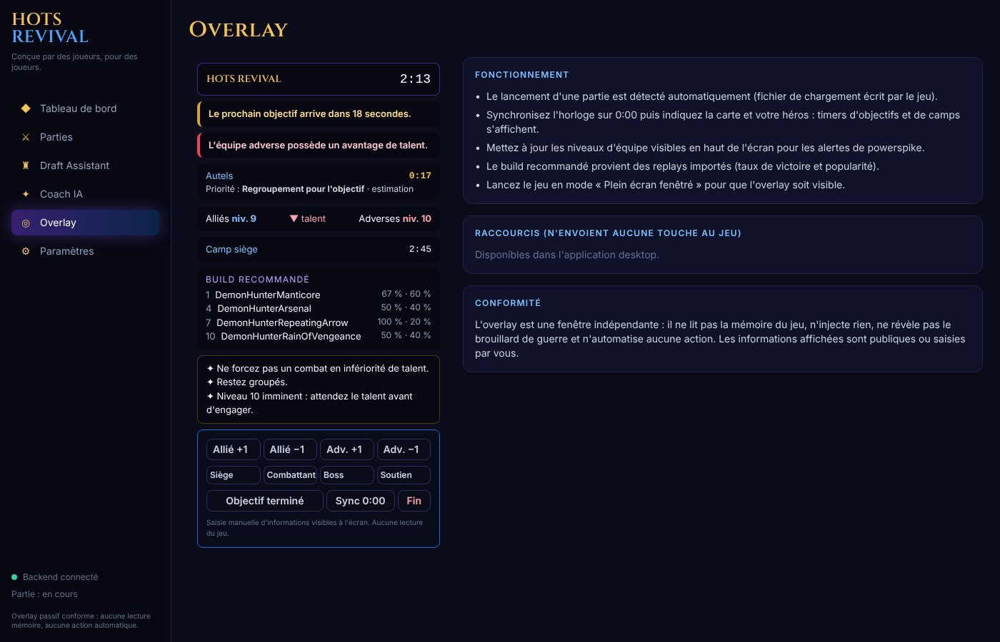

# HOTS REVIVAL

> **Conçue par des joueurs, pour des joueurs.**
> Une intelligence artificielle qui vous accompagne avant, pendant et après chaque partie de *Heroes of the Storm*.

HOTS REVIVAL vise à devenir le « Porofessor » de Heroes of the Storm : profil joueur, Draft Assistant, overlay passif en jeu, rapport post-partie, **HEROS SCORE** et coach personnel propulsé par l'IA de votre choix (Claude, Gemini, ChatGPT, Mistral, Ollama en local…).

**Conforme aux conditions d'utilisation Blizzard par conception :** aucune lecture ou écriture mémoire, aucune injection, aucune macro ni automatisation, aucune information cachée. Seuls les fichiers que le jeu écrit sur le disque (replays, fichier de lobby), les informations publiques et vos propres saisies sont utilisés. → [docs/02-conformite-blizzard.md](docs/02-conformite-blizzard.md)

| Tableau de bord | Rapport post-partie |
|---|---|
|  |  |
| **Draft Assistant** | **Overlay en jeu** |
|  |  |

*(captures réalisées avec les données de démonstration)*

## Modules

| Module | Contenu | Où |
|---|---|---|
| 1. Profil joueur | Winrates global / rôle / héros, tendances, progression, meilleur / pire héros, rôles, héros à éviter | `analytics/profile_stats.py`, page Tableau de bord |
| 2. Draft Assistant | Forces, faiblesses, synergies, menaces (ex. combo E.T.C. + Jaina), counters, win conditions, early/mid/late, picks recommandés | `draft/engine.py`, page Draft |
| 3. Overlay temps réel | Horloge, prochain objectif et priorité, camps, powerspikes, build de talents, conseils | `live/`, fenêtre overlay Electron |
| 4. Coach IA | Chat IA en streaming (Claude, Gemini, ChatGPT, Mistral, OpenRouter, Ollama…) qui connaît votre historique | `coach/`, page Coach IA |
| 5. Analyse de replays | Surveillance du dossier, parsing (heroprotocol officiel), base de données | `replay/` |
| 6. Post Game Report | Résumé, points forts / faibles, moments clés, erreurs, actions excellentes, plan d'amélioration | `analytics/report.py`, page Rapport |
| 7. HEROS SCORE | Placement, Macro, Teamfight, Objectifs, Survie, Draft → note /100 | `analytics/heros_score.py` |
| Méta | Tier lists Icy Veins (générale, master, partie rapide, ARAM), meilleurs duos, builds, synergies, contres — mis à jour automatiquement | `meta/`, page Méta |
| Rang & historique | Toutes les régions du compte, rang Storm League avec historique | page Paramètres |

## Site communautaire

Statistiques de la communauté (tier list, talents, synergies, profils publics) : **https://hots-revival.pages.dev**
Alimenté par les parties des joueurs de l'application : **le partage est activé par défaut** (un résumé pseudonymisé, jamais le replay ni les pseudos), annoncé par un bandeau au premier lancement avant tout envoi, et désactivable d'un clic (Paramètres → Communauté) → [docs/13-plateforme-communautaire.md](docs/13-plateforme-communautaire.md)

## Installation (joueurs)

1. Ouvrez la page **[Releases](https://github.com/BigBlackC0de/HOTS-REVIVAL/releases)** et téléchargez `HOTS-REVIVAL-Setup-x.y.z.exe`.
2. **Double-cliquez** dessus : l'application s'installe (sans droits administrateur), crée un raccourci sur le Bureau et se lance.
3. Si Windows affiche « Windows a protégé votre ordinateur » : **Informations complémentaires → Exécuter quand même** (l'exécutable n'est pas encore signé numériquement).

C'est tout : aucune commande, aucune base de données à installer, aucun fichier à modifier.
Les versions suivantes s'installent depuis l'application (bouton **Mettre à jour**).
- Le dossier de replays (`Documents\Heroes of the Storm\Accounts\…\Replays\Multiplayer`) et votre compte sont **détectés automatiquement** ; vos anciens replays sont importés au premier lancement, puis chaque nouvelle partie est analysée dès sa fin.
- Pour activer le coach IA, choisissez votre IA et collez sa clé dans **Paramètres → Coach IA** (optionnel). Ollama fonctionne en local, sans clé.
- Lancez Heroes of the Storm en **plein écran fenêtré** pour voir l'overlay.
- **Statistiques communautaires** : par défaut, l'application partage un résumé de vos parties (héros, carte, résultat, talents, statistiques ; jamais le replay, le chat ni les pseudos) pour alimenter le site. Un bandeau vous prévient au premier lancement, avant tout envoi ; désactivable à tout moment dans **Paramètres → Communauté**. Le profil public reste désactivé tant que vous ne l'activez pas.
- Données et journal : `%APPDATA%\HOTS REVIVAL\`.

L'installeur est construit automatiquement sur un serveur Windows (GitHub Actions, `.github/workflows/windows-installer.yml`) à chaque mise à jour du code : tests, compilation du moteur d'analyse, vérification qu'il démarre, création de l'installeur, publication dans les Releases.

## Développement

Prérequis : Python ≥ 3.11, Node.js ≥ 20.

**Tester la version locale en un double-clic** : `test-local.cmd` ferme l'application installée, lance le code du dépôt sur une copie de vos données (`%LOCALAPPDATA%\HOTS REVIVAL (test)`, sans import de replays ni partage), puis relance l'application installée quand vous fermez la fenêtre de test. `test-local.cmd reset` repart d'une copie fraîche.

```bash
cd backend && pip install -e ".[dev]" && pytest          # tests (dont conformité)
uvicorn app.main:app --port 8765 --reload                 # API : http://127.0.0.1:8765/docs
cd ../apps/desktop && npm install && npm run dev          # Vite + Electron
```
Par défaut la base est un fichier SQLite dans le dossier de données ; `HOTS_DATABASE_URL=postgresql+psycopg://…` bascule sur PostgreSQL (`docker compose up -d`) pour le mode serveur/équipe. `python scripts/seed_demo.py` crée 30 parties de démonstration.

### Raccourcis de l'overlay (ils n'envoient aucune touche au jeu)
| Raccourci | Action |
|---|---|
| Ctrl+Shift+O | Afficher / masquer l'overlay |
| Ctrl+Shift+I | Mode interactif (cliquer dans l'overlay) |
| Ctrl+Shift+S | Synchroniser l'horloge sur 0:00 |
| Ctrl+Shift+PageUp / PageDown | Niveau allié / adverse +1 |
| Ctrl+Shift+J | Objectif terminé |
| Ctrl+Shift+K | Capturer l'écran pour calibrer la lecture de l'horloge et des niveaux |

L'overlay est automatique : il apparaît au chargement d'une partie (carte détectée), se vide à la fin et disparaît quand le jeu est fermé. Avec la lecture d'écran activée (Paramètres), l'horloge et les niveaux d'équipe sont lus tout seuls.

## Stack
React · TypeScript · Tailwind · Electron · Python · FastAPI · PostgreSQL · Claude API (SDK Anthropic) ou toute API compatible OpenAI · Sentry · PostHog

## Documentation
| # | Livrable |
|---|---|
| 1 | [Architecture complète + diagrammes](docs/01-architecture.md) |
| 2 | [Contraintes et conformité Blizzard](docs/02-conformite-blizzard.md) |
| 3 | [Stratégie temps réel sans lecture mémoire](docs/03-strategie-temps-reel.md) |
| 4 | [MVP en 30 jours](docs/04-mvp-30-jours.md) |
| 5 | [Roadmap V2](docs/05-roadmap-v2.md) |
| 6 | [Base de données](docs/06-base-de-donnees.md) · [DDL](backend/sql/schema.sql) |
| 7 | [Schémas d'API](docs/07-api.md) |
| 8 | [Backlog complet & user stories](docs/08-backlog-user-stories.md) |
| 9 | [Wireframes](docs/09-wireframes.md) |
| 10 | [HEROS SCORE](docs/10-heros-score.md) |
| 11 | [Plan de développement](docs/11-plan-developpement.md) |
| 12 | [Structure des dossiers](docs/12-structure-dossiers.md) |

## État et limites connues
- Le parser est validé sur des replays réels (Storm League, Quick Match, ARAM, IA ; voir `backend/tests/fixtures`).
- Les timings d'objectifs sont mesurés sur replays réels pour certaines cartes et recalibrés sur les replays du joueur ; les autres restent des estimations signalées comme telles.
- La lecture des pages Icy Veins dépend de leur mise en page : en cas de changement, les dernières données valides sont conservées.
- Blizzard ne fournit aucune API Heroes of the Storm (Battle.net compris) : le rang se saisit dans l'application.
- Les profils de héros du Draft Assistant et les seuils du HEROS SCORE sont des valeurs éditoriales v1, à calibrer sur données.
- Le schéma est créé par `create_all` ; les migrations Alembic arrivent avant la première release publique.
- La signature de l'installeur via SignPath Foundation est en cours de mise en place ([détails](docs/signature-du-code.md)).

## Politique de signature du code / Code signing policy

Free code signing provided by [SignPath.io](https://about.signpath.io), certificate by [SignPath Foundation](https://signpath.org).

- **Committers and reviewers:** [members of the AzsraProjects organization](https://github.com/AzsraProjects)
- **Approvers:** [owners of the AzsraProjects organization](https://github.com/AzsraProjects)

Only binaries built by GitHub Actions from this repository's tagged releases are signed: `HOTS REVIVAL.exe`, `hots-backend.exe` and the `HOTS-REVIVAL-Setup-*.exe` installer.

**Privacy policy:** this program does not read game memory, inject anything or send keystrokes to the game. It connects to other networked systems only for these purposes:
- checking for and downloading updates from GitHub Releases;
- sharing a summary of the player's matches (heroes, map, result, talents, statistics; never the replay file, chat or player names) with the community platform https://hots-revival.pages.dev. This is enabled by default, the player is informed on first launch before anything is sent, and it can be disabled at any time in Settings → Community;
- reading public hero guides from Icy Veins;
- the AI coach, only when the player configures it with an AI provider of their choice (and their own key when that provider requires one).

## Licence

[MIT](LICENSE)

*Heroes of the Storm est une marque de Blizzard Entertainment. HOTS REVIVAL est un projet indépendant, non affilié à Blizzard.*
